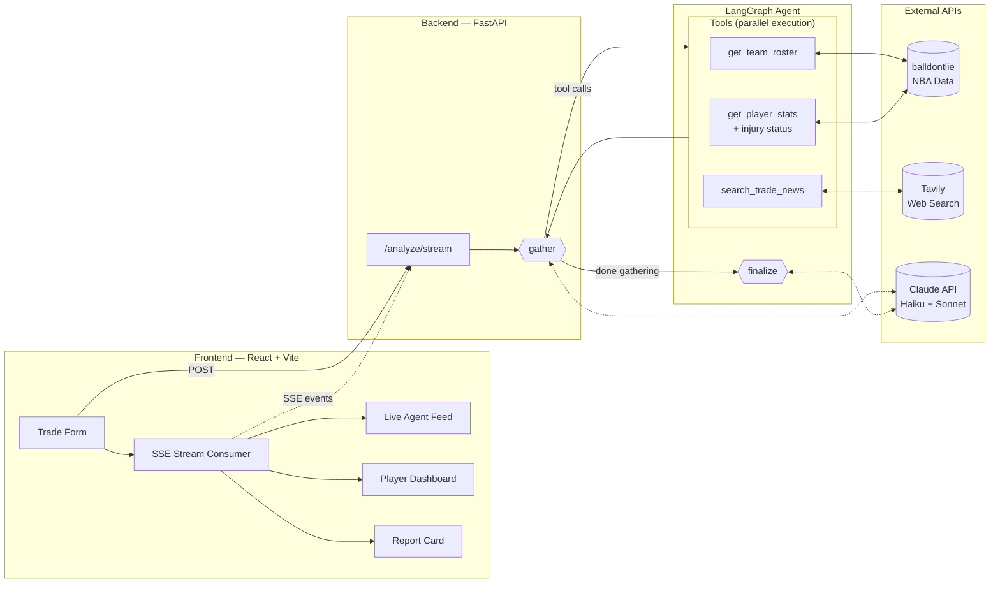

# Trade Desk - Live Agent Trade Analysis

Describe an NBA trade or signing. A LangGraph agent pulls real rosters, live stats, injury reports, and breaking news, then grades it like a front-office analyst on deadline — live, in front of you, with the reasoning visible as it happens.

Built for **United Hacks V7** (Sport Track).

<p align="left">
  
  
  
  
  
  
  
  
  
  
</p>

---

## What it does

Type a move — *"LeBron James signs with the Mavericks"* — and pick the team you're evaluating for. An autonomous agent:

1. Pulls the real current roster for both teams involved
2. Looks up season stats **and current injury status** for the traded player plus at least one key incumbent whose fit is affected
3. Searches recent news for trade context and reactions
4. Reasons through it and produces a graded report — letter grade, win-probability delta, stat comparisons, a historical parallel when one genuinely fits, and cited sources

You watch it happen live: each tool call shows up the moment it starts (with a spinner, then a result summary and timing), player stat cards fill in as their lookups finish, and the report card lands at the end.

The report includes a letter grade (A+ to F), win-outlook delta, a confidence level, upside and risk bullets, a grade for the other team in the deal, a before/after stat breakdown, the analyst take, and cited sources.

Other things the UI does:

- **Recent analyses** are saved locally, so you can flip back to an earlier report without re-running it
- **Copy summary / Copy link**: plain-text report for Slack or WhatsApp, or a `?team=&move=` link that pre-fills the form
- **Stop** a run mid-way (the backend cancels the agent too, so no tokens get burned for nothing)
- **Backend health indicator** with warnings when the server is offline or missing API keys

The agent decides on its own which players matter enough to check — nobody hand-picks who gets analyzed.

## Architecture



**Design choices worth knowing:**

- **Two models, one graph.** The `gather` node runs on Haiku (fast, cheap, fine for tool orchestration); `finalize` runs on Sonnet (slower, but this is where analysis quality actually matters).
- **Tool calls execute concurrently**, not sequentially — when the agent needs both teams' rosters, it fires both requests at once via `asyncio.gather`.
- **Structured output is forced**, not parsed. The final report is generated via a tool call with `tool_choice` forced to `finalize_report`, guaranteeing valid JSON every time instead of hoping the model formats free text correctly.
- **Three-tier stat fallback.** `season_averages` (highest API tier) → averaging individual game logs ourselves (mid tier) → bio data only (free tier). The app degrades gracefully instead of breaking if a data source isn't available.
- **Live events, not batched ones.** Nodes push events through a callback in the LangGraph run config, so tool start/finish reach the UI as they happen instead of after the whole turn.
- **Bounded and fail-safe.** The gather loop is capped (`MAX_GATHER_TURNS`), the whole run has a timeout, every tool returns `{"error": ...}` instead of raising, and any failure becomes an `error` SSE event so the UI never hangs on a spinner.
- **Season-aware.** The current season is computed from today's date (falls back to last season if no games yet). Game-log averages skip DNPs and playoff games, and shooting % is weighted by attempts.
- **Raw data bypasses the LLM where it matters.** Player stats and injury status are captured directly from tool results and sent to the frontend as-is — never transcribed by Claude into the report, so the dashboard numbers can't drift from what the API actually returned.

## Tech stack

| Layer | Tech |
|---|---|
| Agent orchestration | LangGraph, Anthropic Claude (Haiku 4.5 + Sonnet 4.6) |
| Backend | FastAPI, Server-Sent Events, async httpx |
| Frontend | React 18, Vite, plain CSS (no framework) |
| Sports data | [balldontlie](https://balldontlie.io) (ALL-STAR tier) |
| News search | [Tavily](https://tavily.com) |
| Visuals | Custom BorderGlow (interactive card glow), Prism (WebGL/OGL background) |

## Project structure

```
trade-impact-agent/
├── backend/
│   ├── agent.py              # LangGraph graph: gather -> finalize
│   ├── tools.py               # balldontlie + Tavily tool implementations
│   ├── main.py                 # FastAPI app, SSE streaming endpoint
│   ├── diagnose_balldontlie.py # standalone API diagnostic script
│   ├── tests/                  # offline tests (fake LLM + mocked HTTP)
│   └── requirements.txt
└── frontend/
    ├── src/
    │   ├── App.jsx
    │   ├── components/         # TradeForm, LiveFeed, PlayerDashboard, ReportCard,
    │   │                        # Card, BorderGlow, Prism
    │   └── lib/api.js          # hand-rolled SSE client
    └── package.json
```

## Running locally

**Backend**
```bash
cd backend
python -m venv venv && source venv/bin/activate   # Windows: venv\Scripts\activate
pip install -r requirements.txt
cp .env.example .env   # fill in your 3 API keys
python main.py          # -> http://localhost:8000
```

**Frontend**
```bash
cd frontend
cp .env.example .env    # point VITE_API_URL at your backend
npm install
npm run dev              # -> http://localhost:5173
```

**Tests** (no API keys needed)
```bash
cd backend
pip install -r requirements-dev.txt
pytest -q
```

### Environment variables

| Key | Where to get it | Notes |
|---|---|---|
| `ANTHROPIC_API_KEY` | [console.anthropic.com](https://console.anthropic.com) | |
| `TAVILY_API_KEY` | [tavily.com](https://tavily.com) | |
| `BALLDONTLIE_API_KEY` | [balldontlie.io](https://balldontlie.io) | Free tier works with reduced fidelity; **ALL-STAR ($9.99/mo)** unlocks real per-game stats and injury data |

Optional backend settings (see `backend/.env.example`): `PORT`, `ALLOWED_ORIGINS`, `GATHER_MODEL`, `FINALIZE_MODEL`, `MAX_GATHER_TURNS`, `RUN_TIMEOUT_SECONDS`, `MAX_CONCURRENT_RUNS`, `RATE_LIMIT_PER_HOUR` (per IP, protects your API spend on a public deploy).

## Deployment

Built to deploy as two separate services:

- **Backend -> [Railway](https://railway.app)** — set the 3 environment variables above in the Railway dashboard, Railway auto-detects the FastAPI app via `main.py` (it reads Railway's `PORT`). Set `ALLOWED_ORIGINS` to your Vercel URL.
- **Frontend -> [Vercel](https://vercel.com)** — set `VITE_API_URL` to your deployed Railway backend URL before building.

## License

MIT — see [LICENSE](./LICENSE).
